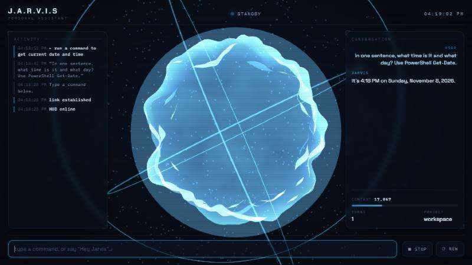
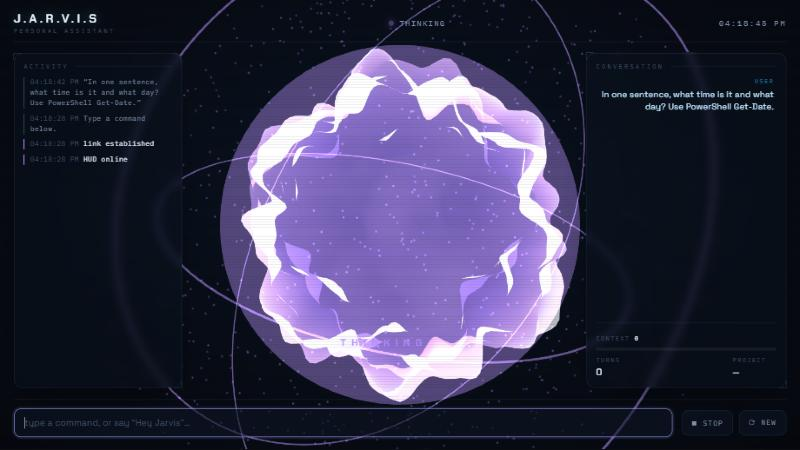

<div align="center">



<h1>⟡ PROJECT·DUME ⟡</h1>

<b>A voice &amp; screen assistant for Windows — with the mind of Claude.</b><br/>
<sub>Say “Hey Jarvis”. It listens, thinks, talks back, reads your screen, and gets things done — behind a movie-style HUD.</sub>

<br/><br/>


<br/>


</div>

---

<div align="center">

<br/><sub>The live HUD — a reactive energy core that changes colour with what JARVIS is doing, a live activity feed, the conversation, and a context meter.</sub>
</div>

---

## ✦ What it does

> 🎙️ **Hears you** — say *“Hey Jarvis”* once, then just talk. It waits through natural pauses and only replies when your sentence sounds finished.
> 🧠 **Thinks with Claude** — the Claude Code CLI is the brain, on your own subscription (no API key).
> 🗣️ **Talks back** — a calm British voice, streamed sentence-by-sentence as Claude writes.
> 👁️ **Reads your screen** — window text, OCR, or a screenshot, whichever is cheapest.
> 🖥️ **Runs your PC** — full terminal and desktop control, with hard safety limits.
> 🌌 **Shows it all** — a three.js HUD that glows, pulses to your voice, and never looks like a terminal.

## ✦ Personal &amp; always-on

- **Knows you** — addresses you as *“Sir”*, greets you by name, and remembers you between sessions.
- **Learns how you work** — after each conversation it distils your projects, tools, hours and habits into `memory/profile.md` and uses them next time, so answers fit your style without being asked.
- **Always there** — starts at login and waits for *“Hey Jarvis”*:
  ```bash
  python -m jarvis.main --install-autostart      # (and --uninstall-autostart)
  ```
- **Your day, done by voice** — once you connect Gmail, Notion, Calendar and GitHub (`/mcp`, then `integrations.use_my_connectors: true`), it checks mail, your Notion tasks, your calendar and your PRs, and brain-bursts on code with you.

📋 **See the full [20-feature roadmap →](FEATURES.md)**

## ✦ The core, by state

| State | Colour | Meaning |
|:--|:--|:--|
| ● **Standby** | steel blue | waiting for “Hey Jarvis” |
| ● **Listening** | cyan | hearing you — your words appear live |
| ● **Thinking** | violet | Claude is working it out |
| ● **Speaking** | bright cyan | replying out loud |
| ● **Working** | amber | acting on your desktop |

<div align="center">

<br/><sub>Thinking — the core turns violet and churns while Claude reasons.</sub>
</div>

## ✦ Quickstart

```bash
python -m venv .venv
.venv\Scripts\python -m pip install -r requirements.txt
```

Then **double-click `Start JARVIS.vbs`** — the HUD opens in its own window, no terminal.

```bash
# or from a terminal
.venv\Scripts\python -m jarvis.main            # HUD + voice + text box
.venv\Scripts\python -m jarvis.main --no-voice # HUD only, type in the box
.venv\Scripts\python -m jarvis.main --text     # plain terminal (debug)
```

> **Needs:** Windows 11, Python 3.12, an NVIDIA GPU (optional, speeds up speech-to-text),
> and the [Claude Code](https://claude.com/claude-code) CLI signed in. The HUD loads three.js from a CDN on first run.

## ✦ Say anything

| Say / type | What happens |
|:--|:--|
| *anything* | goes to Claude; the reply is spoken and shown |
| *“new session”* | fresh conversation (a summary is kept) |
| *“switch project to &lt;name&gt;”* | work in that folder |
| *“remember &lt;something&gt;”* | saved for every future session |
| *“status”* | session size and working folder |
| *“goodbye”* | quit |

**Kill switch:** `Ctrl+Alt+J` (or the HUD **stop** button) halts the task and blocks all desktop actions until your next request.

## ✦ What it's allowed to do

Full terminal and desktop access, with two limits in [`command_policy.yaml`](jarvis/command_policy.yaml):

```diff
- BLOCKED  never runs, even if you say yes
    rm -rf and every recursive forced delete · deleting a drive root,
    Windows, Program Files or your user folder · formatting a disk
! CONFIRM  runs only after you approve (voice "yes" or the HUD)
    any delete · shutdown/restart · killing processes · installing software
    registry / service / scheduled-task changes · git history rewrites
+ ALLOWED  everything else runs freely
```

Two layers enforce it: the confirmation step, **and** a Claude Code `PreToolUse` hook that denies blocked commands even if a tool was pre-approved.

## ✦ How it fits together

```
  🎙  mic ─▶ "Hey Jarvis" ─▶ silero VAD ─▶ faster-whisper (GPU) ─▶ text
                                                                    │
                                                        ┌───────────▼───────────┐
   ⌨  HUD text box ──────────────────────────────────▶ │   Assistant (policy)  │
                                                        └───────────┬───────────┘
                                                 claude -p --stream-json --resume
                                                        │  tools · desktop MCP
                                                        ▼
   streamed reply ─▶ sentences ─▶ edge-tts 🔊     +     live events ─▶ three.js HUD 🌌
```

## ✦ Keeping usage low

- New session after **15 min idle** or **60k tokens** — a Haiku-written summary carries over.
- Only JARVIS's own tools are loaded, so a turn starts at ~15k tokens.
- Screen reading is text-first: window list → UI tree → OCR → screenshot last.
- Local commands (new session, status, remember…) never call Claude.

## ✦ Project map

```
Start JARVIS.vbs          no-terminal launcher
jarvis/main.py            boots the HUD server, window, voice, kill switch
jarvis/assistant.py       orchestrator: voice + HUD → Claude → speech + HUD
jarvis/voice_loop.py      wake → listen (live level + partial) → assistant
jarvis/policy.py          command classifier (allow / confirm / block)
jarvis/guard_hook.py      Claude Code PreToolUse hook — hard block backstop
jarvis/bus.py · ui_server.py   event bus + SSE server for the HUD
jarvis/hud/               the three.js HUD (index.html, core.js, app.js, hud.css)
jarvis/brain/             runs `claude -p`, session resume / rotate / summary
jarvis/desktop_mcp/       screen reading + mouse/keyboard (MCP server)
jarvis/audio/             wake word · speech-to-text · text-to-speech
```

<div align="center">
<br/>
<sub>Built by <b>Nishant Sharma</b> · powered locally, thinks with Claude.</sub>
<br/>

</div>
